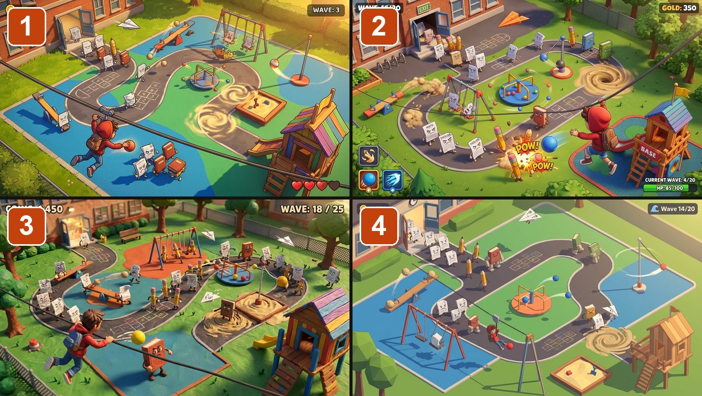
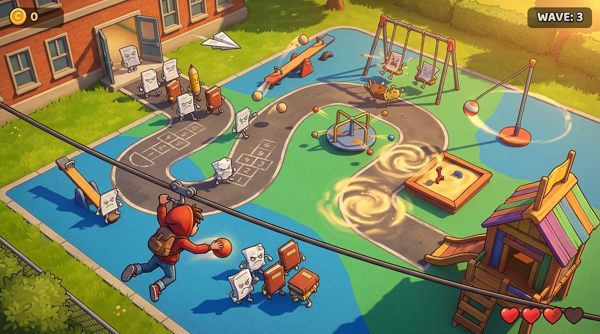
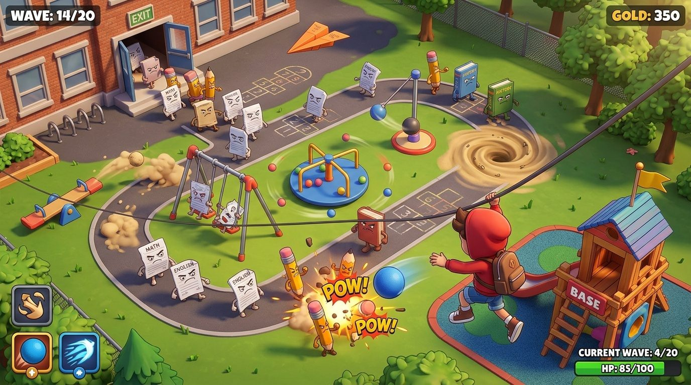
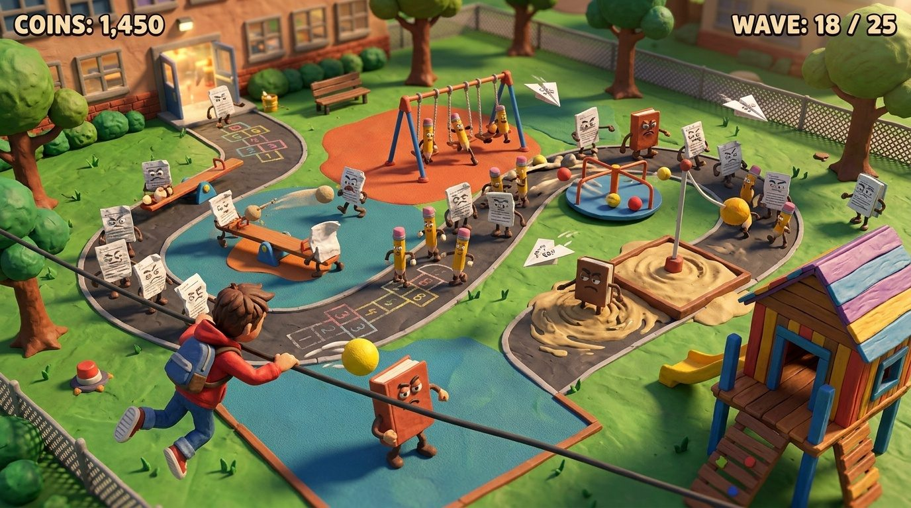
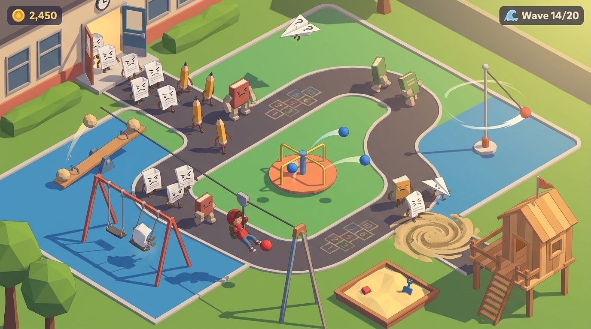

# Which look would you play?

A tower defense game where you play a kid defending the playground from an army of living homework. The defenses are real playground equipment: seesaws, swings, the merry-go-round, tetherball and the sandbox. Here is the same schoolyard in four art styles.

**See them full size:** https://trashpanda62.github.io/playground-td-looks/

**Tell us** which number you like best (1 to 4) and why: reply to whoever sent you the link.

## 1 · Painted diorama

Hand-painted textures on chunky 3d, warm light.

## 2 · Glossy toy

Bright, smooth vinyl-toy 3d.

## 3 · Clay

Handmade plasticine, stop-motion lighting.

## 4 · Low-poly

Flat-shaded, minimal 3d.

Mock-ups made with an image model, not game footage.
